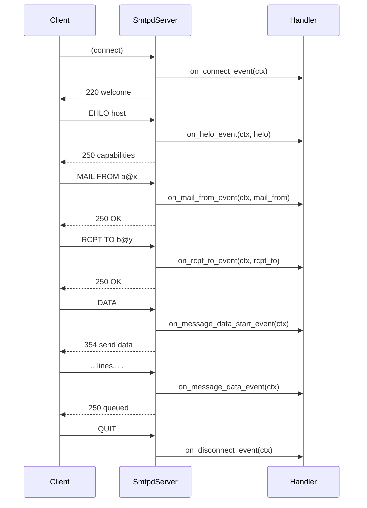

# The ```smtpd``` core library

```tokeo.core.smtpd``` is a standalone, ```asyncio```-based SMTP receiving
server. You write a small handler class; the server runs the SMTP conversation,
calls your handler at each step, and turns your decisions into the correct SMTP
responses.

Note: Tokeo smtpd is based on MidiSmtpServer, a faithful, one-to-one port of
the Ruby gem
[midi-smtp-server](https://github.com/4commerce-technologies-AG/midi-smtp-server):
the events, the context object, the configuration options, the exceptions and the
lifecycle all mirror the original, so existing handlers port over directly. You do
not need to know the original to use the library.

.. note::

    Receiving only. This is the daemon that *accepts* incoming mail. To *send*
    mail, use a client library instead.

.. note::

    This page documents the library (```tokeo.core.smtpd```): you construct
    and drive ```SmtpdServer``` yourself. Running it as a managed Cement service
    (config blocks, CLI, pre-forking) is the job of the ```tokeo.ext.smtpd```
    extension and is documented there.

## 1. What you build

Two things:

1. A handler class: a subclass of ```SmtpdEvents``` with the event methods
   you care about. Every event has a safe default, so you override only what you
   need.
2. A server: an ```SmtpdServer``` bound to your handler, told which ports and
   hosts to listen on, then served.

## 2. Quick start

```python
import asyncio
from tokeo.core.smtpd import SmtpdServer, SmtpdEvents, Smtpd550Exception


class MailHandler(SmtpdEvents):

    def on_rcpt_to_event(self, ctx, rcpt_to):
        # only accept mail addressed to our domain, reject the rest
        if not rcpt_to.strip('<>').endswith('@example.com'):
            raise Smtpd550Exception             # client sees "550 ..."
        return True                             # accept the address as sent

    def on_message_data_event(self, ctx):
        # the complete message has arrived; do something with it
        print('from:', ctx.envelope.mail_from)
        print('to:  ', ctx.envelope.rcpt_tos)
        print(bytes(ctx.message.data).decode('utf-8', 'replace'))


async def main():
    server = SmtpdServer(MailHandler(), ports=2525, hosts='127.0.0.1')
    await server.start()          # bind and serve in the background
    try:
        await server.join()       # run until stopped
    finally:
        await server.stop()


asyncio.run(main())
```

Point any mail client at ```127.0.0.1:2525``` and send a message.

## 3. How it fits together

The server accepts a TCP connection and drives the SMTP conversation on it. At
each meaningful step it calls your handler; your return value or raised
exception becomes the SMTP response.


One connection walks through the SMTP command sequence. The server enforces the
ordering (```HELO``` before ```MAIL```, ```MAIL``` before ```RCPT```, and so on)
and calls your handler at each stage:



## 4. Events

Your handler subclasses ```SmtpdEvents``` and overrides the events it needs.
Every event has a safe default (accept and continue), so a handler can be as small
as a single method. The full set, in the order they can occur:

<table border="1" cellpadding="6" cellspacing="0">
<thead>
<tr><th>Event</th><th>Called</th><th>Argument(s) beyond ctx</th></tr>
</thead>
<tbody>
<tr><td>on_connect_event</td><td>new connection accepted</td><td>-</td></tr>
<tr><td>on_proxy_event</td><td>after a valid PROXY line</td><td>proxy_data</td></tr>
<tr><td>on_helo_event</td><td>on HELO/EHLO</td><td>helo_data</td></tr>
<tr><td>on_auth_event</td><td>on AUTH (see below)</td><td>authorization_id, authentication_id, authentication</td></tr>
<tr><td>on_mail_from_event</td><td>on MAIL FROM</td><td>mail_from_data</td></tr>
<tr><td>on_rcpt_to_event</td><td>on RCPT TO</td><td>rcpt_to_data</td></tr>
<tr><td>on_message_data_start_event</td><td>DATA accepted, before body</td><td>-</td></tr>
<tr><td>on_message_data_receiving_event</td><td>repeatedly, while the body arrives</td><td>-</td></tr>
<tr><td>on_message_data_headers_event</td><td>when the header/body boundary is reached</td><td>-</td></tr>
<tr><td>on_message_data_event</td><td>the complete message has arrived</td><td>-</td></tr>
<tr><td>on_process_line_unknown_event</td><td>an unrecognized command line</td><td>line</td></tr>
<tr><td>on_disconnect_event</td><td>connection closing</td><td>-</td></tr>
<tr><td>on_logging_event</td><td>a log message is emitted</td><td>severity, msg, err=None</td></tr>
</tbody>
</table>

Two conventions matter:

- The return value decides. ```on_mail_from_event``` and ```on_rcpt_to_event```
  decide by their result: ```True``` accepts the address as sent, a stripped string
  accepts it as the replaced address (also ```''```), ```None``` or ```False```
  refuses it by ```550```. Any other result, a string with surrounding whitespace or
  an exception other than an ```Smtpd*Exception``` is a fault of the handler and
  answered by ```451```. Not overriding the event accepts every address.
  ```on_process_line_unknown_event``` answers an unknown line by a returned single
  reply line with its code (e.g. ```'250 OK'```), by ```500``` on ```None``` or
  ```False```, and by ```451``` on any other result. ```on_proxy_event``` updates
  the fields of ```ctx.server.proxy``` by a returned ```dict``` (also ```{}```),
  keeps them on ```None``` and ends the connection by ```421``` on any other result.
- Raising decides the reply. Raise one of the ```Smtpd*Exception``` classes
  (section 7) to reject a step; the exception carries the SMTP status line the
  client receives.

.. note::

    ```on_message_data_receiving_event``` runs once per received line and is on
    the hot path. Keep it fast and do not decorate it with ```@threaded```; the
    library rejects that at import time.

    A fault within DATA (raised by ```on_message_data_start_event```,
    ```on_message_data_headers_event``` or ```on_message_data_receiving_event```,
    or a message over ```data_size```) is answered once after the end of DATA;
    the server discards the rest of the message without further events
    (RFC 1870). Any other error than an ```Smtpd*Exception``` answers 451,
    the original error is its ```__cause__```. The fault is logged as ERROR
    when it occurs (```Error within DATA, further DATA is ignored up to its
    end: ...```); at the end it is counted once and logged with its reply.

### Slow work: ```@threaded```

If an event does something slow (a database call, a network request), decorate it
with ```threaded``` so it runs in a worker thread instead of blocking the event
loop:

```python
from tokeo.core.smtpd import SmtpdEvents, threaded


class MailHandler(SmtpdEvents):

    @threaded
    def on_message_data_event(self, ctx):
        store_in_database(bytes(ctx.message.data))   # slow, offloaded
```

```@threaded``` may only be applied to regular (```def```) events, never to
per-line events and never to ```async def``` events (a coroutine can already
```await```).

### Helpers

Inside a handler, two helpers report connection state:
```self.authenticated(ctx)``` is true once the client has authenticated, and
```self.encrypted(ctx)``` is true once the connection is running over TLS.
They only report ```ctx.server.authenticated``` and ```ctx.server.encrypted```:
the server checks these fields itself, so overriding a helper does not change
its decisions, unlike ```authenticated?```/```encrypted?``` of the original.

## 5. The context object

Every event receives the same per-connection ```ctx``` (an ```SmtpdContext```),
which carries the whole state of the conversation. It has three parts:

```ctx.server``` holds the connection and session:
```local_host```, ```local_ip```, ```local_port```, ```remote_host```,
```remote_ip```, ```remote_port```, ```helo```, ```proxy```, ```connected```,
```authorization_id```, ```authentication_id```, ```authenticated```,
```encrypted```, plus ```exceptions``` and ```errors``` accumulated during the
session.

```ctx.envelope``` holds the current transaction:
```mail_from``` (the sender), ```rcpt_tos``` (the list of recipients),
```encoding_body```, ```encoding_utf8```, ```auth_for_id``` and
```auth_for_id_raw``` (section 6).

```ctx.message``` holds the message being received:
```data``` (a ```bytearray``` of the raw message), ```bytesize```,
```received```, ```delivered```, ```headers``` and ```crlf```.

A transaction (envelope + message) resets after each delivered message or a
```RSET```, while the server/session part persists for the life of the connection.

.. note::

    ```ctx.message.data``` is a ```bytearray```; wrap it in ```bytes(...)``` (and
    decode) when you need an immutable copy or text.

```SmtpdContextEncoder``` is provided to serialize a context to JSON (it drops the
raw ```data``` body), which is handy for logging or enqueuing a job.

## 6. Authentication

```AUTH PLAIN``` and ```AUTH LOGIN``` are supported. Set ```auth_mode``` to
```'AUTH_OPTIONAL'``` (offer it) or ```'AUTH_REQUIRED'``` (require it before
```MAIL```); the default is ```'AUTH_FORBIDDEN'``` (not offered).

You decide who may authenticate in ```on_auth_event```. Return the
```authorization_id``` as a non-empty string to grant access; raise
```Smtpd535Exception``` to deny. Any other result is denied by 535 as well.
The string must be stripped. Leading or trailing whitespace is a fault of
the handler and answered by ```454 Temporary authentication failure```, like
any exception of ```on_auth_event``` other than an ```SmtpdException```.
A client may send an ```authorization_id``` to act as another identity
(AUTH PLAIN); return it only after you checked that the
```authentication_id``` may act as it:

```python
class MailHandler(SmtpdEvents):

    def on_auth_event(self, ctx, authorization_id, authentication_id, authentication):
        if authentication_id == 'admin' and authentication == 's3cret':
            return 'admin'                 # granted; stored as authorization_id
        raise Smtpd535Exception            # "535 authentication failed"
```

By default (no override) ```on_auth_event``` denies every attempt.

A relay may name the original submitter of a message by the ```AUTH```
parameter of ```MAIL FROM``` (RFC 4954), e.g. Alice submits to relay A, which
logs in at your server and sends ```MAIL FROM:<alice@a> AUTH=alice@a```. The
server removes the parameter from the sender and decodes it (xtext) into
```ctx.envelope.auth_for_id_raw```, kept as sent for logging. It trusts the
value only when the client is logged in with an ```authorization_id``` listed
in ```trusted_relay_auth_ids```, then ```ctx.envelope.auth_for_id``` carries
the submitter stripped of surrounding whitespace. In all other cases, also for
```AUTH=<>```, ```auth_for_id``` stays ```''```. An invalid xtext is answered
by ```501```.

Both sides of this trust are checked automatically to be stripped: the entries
of ```trusted_relay_auth_ids``` when the server starts (else a
```ValueError```) and the ```authorization_id``` returned by
```on_auth_event``` (else ```454```, see above). So an id only matches as
written, without hidden whitespace.

While AUTH is not offered on the channel (```'AUTH_FORBIDDEN'```, or before
```STARTTLS``` with ```'TLS_WHEN_AUTH'```/```'TLS_REQUIRED'```) the parameter is
not announced and answered by ```555``` (section 7).

## 7. Responses and exceptions

Successful steps produce the standard ```2xx```/```3xx``` replies automatically.
To reject a step, raise the matching exception; each one carries its SMTP status
line. The available classes (all importable from ```tokeo.core.smtpd```):

<table border="1" cellpadding="6" cellspacing="0">
<thead>
<tr><th>Exception</th><th>Reply</th><th>Typical use</th></tr>
</thead>
<tbody>
<tr><td>Smtpd421CloseException</td><td>421 service not available</td><td>abort the connection for a temporary reason; closes the connection</td></tr>
<tr><td>Smtpd521CloseException</td><td>521 does not accept mail</td><td>a host that never accepts mail (RFC 7504); closes the connection</td></tr>
<tr><td>Smtpd554CloseException</td><td>554 transaction failed</td><td>refuse a client, e.g. in on_connect_event; closes the connection</td></tr>
<tr><td>Smtpd421AbortException<br>Smtpd554AbortException</td><td>421 / 554 as above</td><td>abort at once, also within DATA, e.g. malware found while receiving</td></tr>
<tr><td>Smtpd450Exception<br>Smtpd451Exception<br>Smtpd452Exception</td><td>4xx temporary</td><td>greylisting, transient failure</td></tr>
<tr><td>Smtpd500Exception<br>Smtpd501Exception<br>Smtpd502Exception</td><td>syntax / not implemented</td><td>bad or unsupported command</td></tr>
<tr><td>Smtpd503Exception</td><td>503 bad sequence</td><td>command out of order</td></tr>
<tr><td>Smtpd530Exception</td><td>530 authentication required</td><td>gate before MAIL</td></tr>
<tr><td>Smtpd535Exception</td><td>535 authentication failed</td><td>deny AUTH</td></tr>
<tr><td>Smtpd550Exception<br>Smtpd552Exception<br>Smtpd553Exception<br>Smtpd554Exception</td><td>5xx permanent</td><td>reject recipient / message</td></tr>
<tr><td>Smtpd555Exception</td><td>555 parameters not recognized or not implemented</td><td>reject MAIL / RCPT parameters</td></tr>
<tr><td>Tls454Exception<br>Tls530Exception</td><td>TLS-related</td><td>STARTTLS problems / TLS required</td></tr>
</tbody>
</table>

The full set is present (```Smtpd432```, ```Smtpd454```, ```Smtpd534```,
```Smtpd538```, and the pipelining/CRLF ```Smtpd500``` variants).

Code and text are fixed by the class, the constructor takes only a message
for the log. An own text, or a code without a class, comes by a subclass, so
no internal detail of a handler reaches the client:

```python
from tokeo.core.smtpd import Smtpd450Exception


class GreylistedException(Smtpd450Exception):
    smtp_text = 'Greylisted, try again later'


raise GreylistedException(f'greylisted {ctx.server.remote_ip}')
```

The closing exceptions and the internal signals of the server are described
below in "Closing the connection".

The replies of the server lean towards broad compatibility: where a client bends
the standard in a harmless way, the server tolerates it, e.g. an address without
angle brackets or a space after the colon of ```MAIL FROM:```/```RCPT TO:```.

The verbs of the commands are recognized in ASCII only, e.g. ```RſET``` is
answered by ```500```. ```whitespace_mode``` decides on unusual whitespace (any
whitespace except SP and HTAB, e.g. a no-break space) and control chars (except
HTAB, e.g. NUL) in a command line and in the AUTH responses (not in the PROXY
header):

- ```WHITESPACE_MODERATE``` (default) strips them at the edges as noise, any
  whitespace separates the verb and the parameters; a control char inside is
  answered by ```501```, unusual whitespace inside stays
- ```WHITESPACE_STRICT``` answers any of them by ```501```, only SP and HTAB
  separate
- ```WHITESPACE_UNSAFE``` strips and separates only by SP and HTAB and hands
  the values with all other chars to the events; the server logs a warning on
  start

Without a valid separator after the verb, e.g. ```EHLO``` and a no-break space
in ```WHITESPACE_STRICT```, the command is unknown (```500```). An argument to
```QUIT```, ```RSET```, ```DATA``` or ```STARTTLS``` is answered by ```501```,
one to ```NOOP``` is ignored (RFC 5321 4.1.1.9). ```HELO```/```EHLO``` without
a domain is left to ```on_helo_event```, without an own handler it is answered
by ```501```.

AUTH answers a response that is not valid base64 by ```501``` (RFC 4954), only
surrounding spaces and a missing padding are tolerated; an empty authentication
id or password is answered by ```535``` without calling ```on_auth_event```.

```MAIL FROM``` and ```RCPT TO``` hand only the address to the event, as sent:
```<a@x>``` or ```a@x```, and ```<>``` or an empty address for the null sender.
Their parameters are checked strictly (RFC 5321 4.1.2). Valid are only those
announced by ```EHLO``` on the channel, all on ```MAIL FROM```:
```BODY=7BIT```/```BODY=8BITMIME``` and ```SMTPUTF8``` with
```internationalization_extensions```, and ```AUTH=``` while AUTH is offered.
Keywords and values are not case sensitive.

- an unknown or not announced parameter, and any parameter of ```RCPT TO```,
  is answered by ```555```
- a malformed parameter, a wrong value, an invalid xtext or a parameter given
  twice on ```MAIL FROM``` is answered by ```501```

### Closing the connection

After the reply of a ```SmtpdCloseException``` (```Smtpd421CloseException```,
```Smtpd521CloseException```, ```Smtpd554CloseException```) the server closes
the connection. Raised by a handler within DATA, the reply follows after the
end of DATA like any other error. A ```SmtpdAbortException```
(```Smtpd421AbortException```, ```Smtpd554AbortException```) closes at once,
also within DATA without reading it to its end (RFC 5321 3.8 for 421, 7.8 for
554). Any other exception raised outside of the dialog, e.g. a
```Smtpd554Exception``` in ```on_connect_event```, closes the connection by
```421```.

The internal signals are aborting exceptions the server raises itself:

- ```SmtpdIOCmdTimeoutException``` (```421```): no complete line within
  ```io_cmd_timeout``` (or ```io_proxy_cmd_timeout``` for the PROXY header),
  or a reply the client did not take within ```io_cmd_timeout```
- ```SmtpdIOSessionTimeoutException``` (```421```): the session lasted longer
  than ```io_session_timeout```, e.g. a client that sends ```NOOP``` without
  end or DATA that the server discards after an error
- ```SmtpdIOBufferOverrunException``` (```554```): a line, a command or in
  DATA, exceeds ```io_buffer_max_size```

```io_session_timeout``` runs from the greeting and is never renewed: it is
the longest time a connection may hold its slot of ```max_processings```, so
the server can serve the clients that wait. It limits only the wait for input
of the client, a reply is cut only by ```io_cmd_timeout```.

A client that does not take its replies, e.g. sends commands but never reads,
is dropped at once on close, the socket does not wait for the send buffer to
be flushed.

All errors of a connection, the signals too, are in ```ctx.server.errors```
when ```on_disconnect_event``` runs. A handler can refuse a client that ran
into the session timeout from then on:

```python
from tokeo.core.smtpd import SmtpdEvents, Smtpd554CloseException, SmtpdIOSessionTimeoutException


class MailHandler(SmtpdEvents):

    def __init__(self, options=None):
        super().__init__(options)
        self.blocked = set()

    def on_connect_event(self, ctx):
        super().on_connect_event(ctx)
        # refuse a client that ran into the session timeout before
        if ctx.server.remote_ip in self.blocked:
            raise Smtpd554CloseException

    def on_disconnect_event(self, ctx):
        super().on_disconnect_event(ctx)
        if any(isinstance(e, SmtpdIOSessionTimeoutException) for e in ctx.server.errors):
            self.blocked.add(ctx.server.remote_ip)
```

The server reads the standard on 521 and 554 by practice: RFC 7504 lets the
session go on after a ```521```, the client may still send ```QUIT```, and
RFC 5321 3.1 expects a server that greets by ```554``` to wait for ```QUIT```
and to answer other commands by ```503```. The server closes the connection at
once after both instead. A refused client gains nothing by further commands,
while its open connection holds a slot of ```max_processings```. To refuse a
single client use ```Smtpd554CloseException```; ```521``` is meant for a host
that never accepts mail (RFC 7504).

### Which replies are valid per command

Not every reply code is allowed after every command. The command/reply sequences
below are the SMTP standard (RFC 821 §4.3) and
are what the server produces for each state. Reply classes: S success,
I intermediate, F failure, E error.

<table border="1" cellpadding="6" cellspacing="0">
<thead>
<tr><th>Command / state</th><th>Success (S)</th><th>Failure (F)</th><th>Error (E)</th></tr>
</thead>
<tbody>
<tr><td>Connection established</td><td>220</td><td>421</td><td>-</td></tr>
<tr><td>HELO / EHLO</td><td>250</td><td>-</td><td>500, 501, 504, 421</td></tr>
<tr><td>MAIL FROM</td><td>250</td><td>552, 451, 452</td><td>500, 501, 421</td></tr>
<tr><td>RCPT TO</td><td>250, 251</td><td>550, 551, 552, 553, 450, 451, 452</td><td>500, 501, 503, 421</td></tr>
<tr><td>DATA (accept)</td><td>I: 354</td><td>451, 554</td><td>500, 501, 503, 421</td></tr>
<tr><td>DATA (after body)</td><td>250</td><td>552, 554, 451, 452</td><td>-</td></tr>
<tr><td>RSET</td><td>250</td><td>-</td><td>500, 501, 504, 421</td></tr>
<tr><td>NOOP</td><td>250</td><td>-</td><td>500, 421</td></tr>
<tr><td>QUIT</td><td>221</td><td>-</td><td>500</td></tr>
</tbody>
</table>

The 421 reply (service not available, closing the channel) may be returned for
any command when the server must shut down. Raising the matching ```Smtpd*Exception```
from a handler produces one of the failure/error codes above; returning normally
produces the success code.

## 8. TLS and STARTTLS

Set ```encrypt_mode``` to ```'TLS_OPTIONAL'``` (offer ```STARTTLS```),
```'TLS_WHEN_AUTH'``` (like ```TLS_OPTIONAL```, but ```AUTH``` is only offered
and accepted on an encrypted channel - this mode protects credentials against
a plaintext downgrade) or ```'TLS_REQUIRED'``` (require encryption in any
way, as described in RFC 3207); the default is ```'TLS_FORBIDDEN'```. When
encryption is enabled the server upgrades the connection in place on
```STARTTLS``` and discards any bytes buffered before the handshake, so a
command injected ahead of the handshake can never run over the encrypted
channel.

Set ```encrypt_mode``` to ```'TLS_IMMEDIATE'``` for SMTPS (implicit TLS as in
RFC 8314, usually port 465): the TLS handshake runs right on connect, or
right after the PROXY header with ```proxy_extension``` (section 9), and the
```220``` greeting is the first line on the encrypted channel. STARTTLS is
not offered then and AUTH is available at once. The handshake has to
complete within ```io_cmd_timeout```, otherwise the connection is closed.
Immediate TLS requires Python 3.13.13+ or 3.14.4+: older runtimes lose the
start of the ClientHello that arrives together with the connect or the PROXY
header (CPython gh-142352), the server refuses to start there.

### Certificates

The certificate can be supplied three ways:

```python
# 1. from files on disk
SmtpdServer(handler, encrypt_mode='TLS_REQUIRED',
            tls_cert_path='/etc/ssl/mx.pem', tls_key_path='/etc/ssl/mx.key')

# 2. from PEM strings held in memory (never written to disk)
SmtpdServer(handler, encrypt_mode='TLS_REQUIRED',
            tls_cert=cert_pem_str, tls_key=key_pem_str)

# 3. nothing configured -> a self-signed test certificate is generated
SmtpdServer(handler, encrypt_mode='TLS_OPTIONAL',
            tls_cert_cn='mx.example.com', tls_cert_san=['mx.example.com', '127.0.0.1'])
```

A combined ```.pem``` holding the trust chain and the private key in one file
works as well: pass it as ```tls_cert_path``` alone and leave
```tls_key_path``` unset - the key is then read from the same file.

The self-signed certificate is generated in-process with ```cryptography```
(EC P-256, SHA256, valid for 90 days, serverAuth) - no subprocess and no temp
file is involved. It is meant for tests and debugging only, never for
production. Every server generates its own, so the workers of ```pre_fork```
present different ones; configure a certificate (```tls_cert_path``` or
```tls_cert```) when all have to present the same. To prevent client errors
like ```hostname does not match``` its CN and subject alt names derive from
the hosts and addresses configured on the server (reference behaviour): every
name becomes a subject alt name, a loopback-only setup gets the generic CN
```localhost.local```, otherwise the first name is used - and a configured
```tls_cert_cn``` / ```tls_cert_san``` always wins over the derivation.

.. note::

    The in-memory string certificate is loaded through a RAM-backed file
    descriptor (```tokeo.core.utils.memfd```), because the stdlib
    ```ssl.SSLContext``` only loads a server certificate from a filesystem
    path. The private key never touches disk.

For production generate a certificate from your own authority or use a
trust-center like [LetsEncrypt](https://letsencrypt.org/). A quick guide to
create a self-managed certificate with ```openssl```:

```bash
# create a private key
openssl genrsa -out key.pem 4096
# create a certificate signing request (CSR)
openssl req -new -key key.pem -out csr.pem
# create a SSL certificate
openssl x509 -in csr.pem -out cert.pem -req -signkey key.pem -days 90
```

### Security profile

The default ciphers and TLS floor follow the current Mozilla "Intermediate"
profile: the default minimum is TLS 1.2 (the RFC 8996 minimum for a secure
server), ECDHE is preferred over DHE, and only AEAD suites (AES-GCM,
ChaCha20) are used. Three presets are available via ```tls_methods``` and
```tls_ciphers```: MODERN (```'TLSv1_3'```, TLS 1.3 only), ADVANCED (default,
TLS 1.2+), and LEGACY (```TLS_METHODS_LEGACY``` + ```TLS_CIPHERS_LEGACY```) -
an opt-in that lowers the floor to TLS 1.0 and adds forward-secret SHA1 CBC
suites (but no 3DES/RC4/DES/MD5) to still reach old clients, useful for
opportunistic SMTP TLS where a weakly-encrypted hop beats a cleartext one.
TLS 1.3 key-exchange groups are left at the runtime default, so a build on
OpenSSL 3.5+ negotiates the post-quantum hybrid (X25519MLKEM768)
automatically.

The built ```ssl.SSLContext``` is exposed as ```server.tls.context```, e.g.
to inspect the generated self-signed certificate during debugging.

### Test encrypted communication

While working with encrypted communication it is sometimes hard to test and
check the dialog during development or debugging. The GNU tool
```gnutls-cli``` connects to the running server and proceeds with the
encrypted communication on request:

```bash
# use --insecure when the server runs the self-signed test certificate
gnutls-cli --insecure -s -p 2525 127.0.0.1
```

After launching ```gnutls-cli``` speak the SMTP dialog: send ```EHLO``` and
then ```STARTTLS```. When the server answers ```220```, press Ctrl-D to run
the TLS handshake between ```gnutls-cli``` and the server. The session then
starts over on the encrypted channel (reference behaviour), so begin again
with ```EHLO``` before ```MAIL FROM```.

## 9. The PROXY protocol

To sit behind a proxy or load balancer that speaks the PROXY protocol
(haproxy, version 1), set ```proxy_extension=True```. The PROXY header is
then mandatory as the very first line of each connection: the server sends
no greeting on connect, validates the header (TCP4/TCP6/UNKNOWN, normalized
addresses and ports), stores the parsed result on ```ctx.server.proxy```,
calls ```on_proxy_event``` and answers with the ```220``` greeting only
after that. The original client address is thus available to your handler.

```on_connect_event``` runs before the header, so ```ctx.server.remote_ip```
there is the address of the proxy; this is the place to accept trusted
proxies only.

The server logs and closes the connection with ```421``` when the first line
is not a valid PROXY header, when the header does not arrive within
```io_proxy_cmd_timeout``` seconds (default 5), when processing the header
fails, or when a later line sends PROXY again (a Tokeo safeguard, the
specification only defines the leading header).

Deviations from the specification, kept for compatibility:

- the header is matched case-insensitive
- a bare LF ends the header as well (except with ```CRLF_STRICT```)
- the header length is limited by ```io_buffer_max_size```, not 107 bytes
- only version 1 (text) is supported, a version 2 (binary) header is
  rejected with ```421```

## 10. Listeners, limits and options

The constructor keeps the original option names. Key ones:

<table border="1" cellpadding="6" cellspacing="0">
<thead>
<tr><th>Option</th><th>Default</th><th>Meaning</th></tr>
</thead>
<tbody>
<tr><td>ports</td><td>2525</td><td>port(s); '2525, 3535' or a '2525:3535' range, a comma at the end is ignored</td></tr>
<tr><td>hosts</td><td>127.0.0.1</td><td>host(s); '127.0.0.1, ::1' or '*' for all interfaces (binds 0.0.0.0, and :: when IPv6 is configured), a comma at the end is ignored</td></tr>
<tr><td>max_processings</td><td>4</td><td>connections processed simultaneously</td></tr>
<tr><td>max_connections</td><td>None</td><td>concurrent connections accepted (None = unlimited)</td></tr>
<tr><td>auth_mode</td><td>'AUTH_FORBIDDEN'</td><td>AUTH_OPTIONAL / AUTH_REQUIRED</td></tr>
<tr><td>logger_severity</td><td>'WARNING'</td><td>level of the own stderr logger: DEBUG / INFO / WARNING / ERROR / CRITICAL, not with an own logger (section 13)</td></tr>
<tr><td>trusted_relay_auth_ids</td><td>[]</td><td>authorization ids (stripped, non-empty) of relays trusted to name the submitter by AUTH= (section 6)</td></tr>
<tr><td>encrypt_mode</td><td>'TLS_FORBIDDEN'</td><td>TLS_OPTIONAL / TLS_WHEN_AUTH / TLS_REQUIRED / TLS_IMMEDIATE</td></tr>
<tr><td>crlf_mode</td><td>'CRLF_ENSURE'</td><td>line breaks of all lines: CRLF_ENSURE ends each line with CRLF and drops a bare CR or LF, CRLF_LEAVE keeps the line break as received, CRLF_STRICT rejects a line without CRLF by 500</td></tr>
<tr><td>data_size</td><td>None</td><td>maximum message size in bytes, a larger message is answered by 552 after the end of DATA (None = unlimited)</td></tr>
<tr><td>crlf_data_mode</td><td>'CRLF_DATA_MODERATE', with CRLF_STRICT 'CRLF_DATA_STRICT'</td><td>line breaks in DATA against SMTP smuggling, only &lt;CRLF&gt;.&lt;CRLF&gt; ends DATA: CRLF_DATA_MODERATE keeps a bare CR or LF as data, CRLF_DATA_STRICT answers it by 554 after the end of DATA, CRLF_DATA_STRICT_CLOSE also by 554 and closes the connection then; CRLF_DATA_UNSAFE ends DATA on any dot line and logs a warning on start; CRLF_STRICT allows only the strict modes</td></tr>
<tr><td>whitespace_mode</td><td>'WHITESPACE_MODERATE'</td><td>unusual whitespace and control chars in the command lines: WHITESPACE_MODERATE strips them at the edges, WHITESPACE_STRICT answers them by 501, WHITESPACE_UNSAFE hands them to the events and logs a warning on start (section 7)</td></tr>
<tr><td>pipelining_extension</td><td>False</td><td>advertise PIPELINING</td></tr>
<tr><td>internationalization_extensions</td><td>False</td><td>advertise 8BITMIME and SMTPUTF8</td></tr>
<tr><td>spool</td><td>None</td><td>path and file name prefix for the spool temp files (section 11)</td></tr>
<tr><td>do_dns_reverse_lookup</td><td>True</td><td>resolve the remote host name</td></tr>
<tr><td>io_cmd_timeout</td><td>30</td><td>seconds to await a complete command line and for the client to take a reply, at least 1. When not set the default of DEFAULT_IO_CMD_TIMEOUT is used</td></tr>
<tr><td>io_session_timeout</td><td>3600</td><td>seconds a session may last from the greeting on, never renewed, between 1 and 86400, then 421 and the connection is closed (None = default, section 7)</td></tr>
<tr><td>io_buffer_max_size</td><td>1 MiB</td><td>maximum line length, a positive integer (None = default); a longer command or DATA line is answered by 554 and the connection is closed</td></tr>
<tr><td>proxy_extension</td><td>False</td><td>accept the PROXY protocol</td></tr>
<tr><td>io_proxy_cmd_timeout</td><td>5</td><td>seconds to await the PROXY header line, at least 1. When not set the default of DEFAULT_IO_PROXY_CMD_TIMEOUT is used</td></tr>
</tbody>
</table>

```ports```/```hosts``` are parsed into ```server.ports```, ```server.hosts``` and
the resulting ```server.addresses```. If you call ```serve()```/```start()```
without arguments, the server binds to those addresses; you can also pass explicit
listeners:

```python
await server.start([{'host': '127.0.0.1', 'port': 2525},
                    {'host': '::1', 'port': 2526}])
```

### Line breaks in DATA and SMTP smuggling

SMTP ends a message only by ```<CRLF>.<CRLF>``` (RFC 5321 4.1.1.4). Many
servers also end it by a dot line with a bare LF or CR, for example
```<LF>.<LF>```. When two servers on the way of a message disagree on the end,
a sender can hide a second message inside the first one (SMTP smuggling).

An example: a sender submits one message to its provider, the body contains:

```
Hi!<LF>
.<LF>
MAIL FROM:<ceo@bank.example><CR><LF>
RCPT TO:<victim@example.org><CR><LF>
DATA<CR><LF>
From: ceo@bank.example<CR><LF>
Subject: urgent transfer<CR><LF>
<CR><LF>
Please pay now.<CR><LF>
<CR><LF>.<CR><LF>
```

The provider ends the message only at the final ```<CRLF>.<CRLF>``` and
relays it as one message. A receiving server that ends DATA already at
```<LF>.<LF>``` reads the rest as new commands and accepts a second message
from ```ceo@bank.example```. It arrives from the IP addresses of the provider
and can pass SPF for any domain the provider hosts.

```crlf_data_mode``` decides how the server handles such lines:

- ```CRLF_DATA_MODERATE``` (default) ends DATA only at ```<CRLF>.<CRLF>```; a
  false dot line and the lines after it stay part of the message, so the
  example arrives as one message with its text
- ```CRLF_DATA_STRICT``` rejects the message: the server reads to the real
  end, discards the message and answers once by 554
- ```CRLF_DATA_STRICT_CLOSE``` reads to the real end like
  ```CRLF_DATA_STRICT```, answers by 554 and closes the connection then
  (RFC 5321 7.8), for a client that sends bare line breaks only to attack
- ```CRLF_DATA_UNSAFE``` ends DATA at every dot line like before and is open
  to SMTP smuggling; the server logs a warning on start

A client that ends its message by ```<LF>.<LF>``` gets no end of DATA with the
safe modes and runs into ```io_cmd_timeout```. With ```crlf_mode```
```CRLF_STRICT``` only the strict modes are allowed.

### Sharing limits across services

```max_processings``` and ```max_connections``` are per-server. To cap several
servers against one shared budget (for example when running several listeners in
one process), pass a shared ```GlobalLimits``` to each:

```python
from tokeo.core.smtpd import GlobalLimits

limits = GlobalLimits(max_connections=200, max_processings=50)
server_a = SmtpdServer(handler, ports=2525, global_limits=limits)
server_b = SmtpdServer(handler, ports=2526, global_limits=limits)
```

## 11. Message spooling

With ```spool``` set (a directory ending in ```/```, or directory plus the
start of a file name) every incoming message is streamed to a temp file
named ```<prefix>YYYYMMDD-HHMMSS-<unique>.eml```. The timestamp comes from
the connection start (UTC), the unique part from ```mkstemp```, so parallel
messages and pre-forked workers never collide.

The headers collect in memory first. When they are complete (and after
```on_message_data_headers_event```, so injected header lines are included)
the whole block is written to the file once; from then on body lines go to
the file only. At ```on_message_data_event``` the file holds the complete
de-dot-stuffed, chomped message while ```ctx.message.data``` carries ONLY
the headers (no separator line). ```ctx.message.bytesize``` always counts
the whole message and equals the final file size. Header lines added by the
handler change it too and count against a ```data_size``` cap.

```ctx.message.spooler``` is the owning ```MessageSpooler``` (None without
spooling, and None for a message that ends before a header/body separator).
The file lives until the DATA event ends: take it over via
```spooler.keep(path)``` (moves it, ```os.replace```) or ```spooler.keep()```
(leaves it in place and returns the path), otherwise the server deletes it.
With ```debug=True``` on the server all files are kept, including
interrupted ones.

```keep``` does not flush: called before the message completed it only
relocates the still growing file; the server keeps writing through the
open handle and flushes and closes it as usual, so the content is complete
only after ```on_message_data_event```.

## 12. Lifecycle

```SmtpdServer``` exposes an ```asyncio``` lifecycle:

<table border="1" cellpadding="6" cellspacing="0">
<thead>
<tr><th>Method</th><th>Purpose</th></tr>
</thead>
<tbody>
<tr><td>await serve(listeners=None)</td><td>bind and serve, blocking until stopped</td></tr>
<tr><td>await start(listeners=None)</td><td>bind and serve in the background, then return</td></tr>
<tr><td>await join()</td><td>wait until the server is stopped</td></tr>
<tr><td>await stop(wait_seconds_before_close=2.0, gracefully=True)</td><td>stop accepting, drain in-flight connections, then close</td></tr>
<tr><td>shutdown()</td><td>request a shutdown</td></tr>
<tr><td>shutdown_requested / stopped</td><td>current state flags</td></tr>
<tr><td>connections / processings</td><td>active connection / processing counts</td></tr>
<tr><td>has_connections() / has_processings()</td><td>whether any is currently active</td></tr>
</tbody>
</table>

A graceful ```stop``` stops accepting new connections, lets the connections
already in progress finish (up to the drain window), and only then closes.

A shutdown request ends the current dialog and replies by
```421 Service shutting down and closing transmission channel```. The client's
```QUIT``` command is replied by ```221``` instead. A connection still open
after the drain window is forced down and gets the ```421``` right before it is
dropped.

## 13. Logging

The server exposes a ```logger``` whose ```debug```/```info```/```warning```/
```error```/```critical``` calls are forwarded to your handler's
```on_logging_event(ctx, severity, msg, err=None)```; a handler logs by
```self.log```.

Without an override the default ```on_logging_event``` writes every line by its
severity to the server logger: the ```logger``` given to ```SmtpdServer``` (the
Tokeo extension passes ```app.log```), else an own logger on stderr, e.g.
```2026-10-26 12:00:00: [WARNING] msg```, with the level ```logger_severity```
(default ```'WARNING'```, ```'DEBUG'``` shows the whole dialog). A given logger
keeps its own level, so ```logger_severity``` must not be set with it. A
```CRITICAL``` line with an error is followed by its traceback.

Override that one event to route every server and handler log line wherever you
want, ```super().on_logging_event(...)``` writes to the server logger as well:

```python
from tokeo.core.smtpd import SmtpdEvents, Severity


class MailHandler(SmtpdEvents):

    def on_logging_event(self, ctx, severity, msg, err=None):
        if severity is Severity.ERROR:
            alert(msg)
        print(severity.name, msg)
```

```Severity``` values map onto the standard ```logging``` levels, so they compare
and forward to the ```logging``` module directly.

With ```DEBUG``` the server logs the dialog: ```<<< ``` for a command line
of the client, ```>>> ``` for a reply. A command line is decoded as UTF-8,
other bytes appear as ```\xNN```, and every CR as ```[\r]```, so a bare CR or
a byte used for SMTP smuggling stays visible. The lines of DATA are never
logged.

## 14. Relationship to the reference implementation

The library started as a one-to-one port of the original: the same 13 events,
the same context layout, the same configuration options and attribute
readers, the same AUTH / STARTTLS behaviour and the same lifecycle. Its test
suite started as a direct port of the original test suite. The context is
read by attributes instead of hash keys (```ctx.server.remote_ip``` for
```ctx[:server][:remote_ip]```), its times are ```datetime``` in UTC and the
message is a ```bytearray```.

Since then the library develops further towards RFC conformance and defense,
e.g. the closing exceptions (```SmtpdCloseException```), ```whitespace_mode```,
```crlf_data_mode``` and ```io_session_timeout```. These changes are made here
first and planned as a backport to MidiSmtpServer 4.x, while MidiSmtpServer
3.4.x keeps the original behaviour.

The differences that asyncio forces or Tokeo adds: the events may be
```async def``` (or ```@threaded```) instead of Ruby threads; a certificate may
be supplied as an in-memory PEM string (```tls_cert```/```tls_key```); with
```proxy_extension``` the PROXY header is mandatory as the first line and
answered by the greeting (section 9); and the options that only steered the
polling read of the original (```io_waitreadable_sleep```,
```io_buffer_chunk_size```) are left out because ```asyncio``` is
event-driven.
