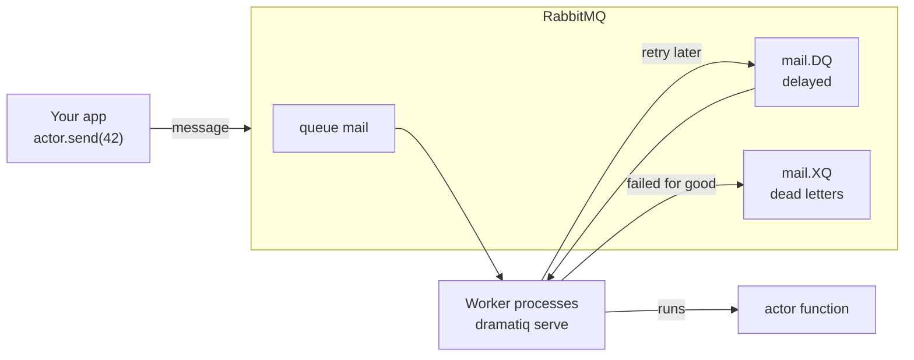
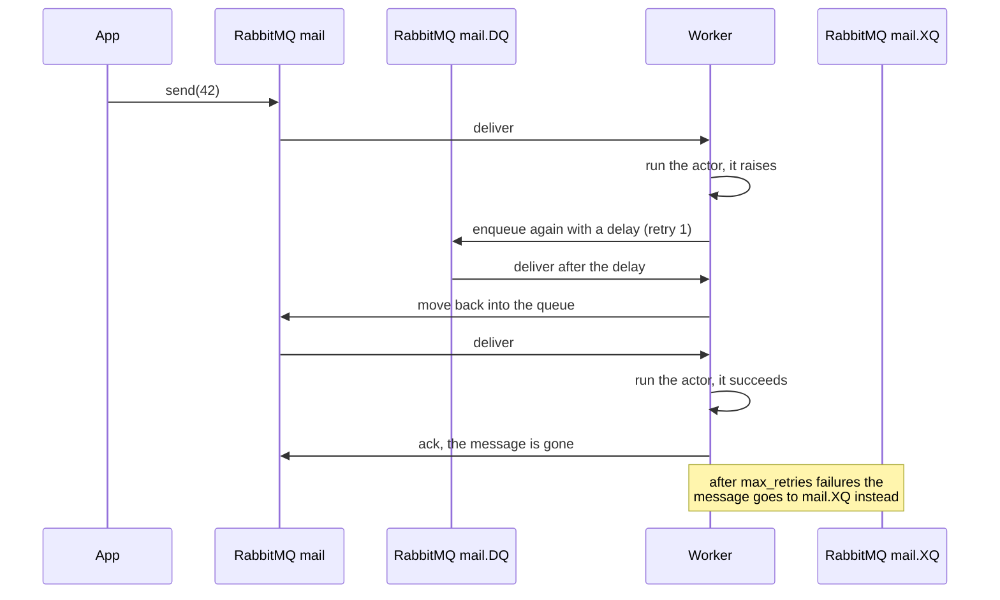
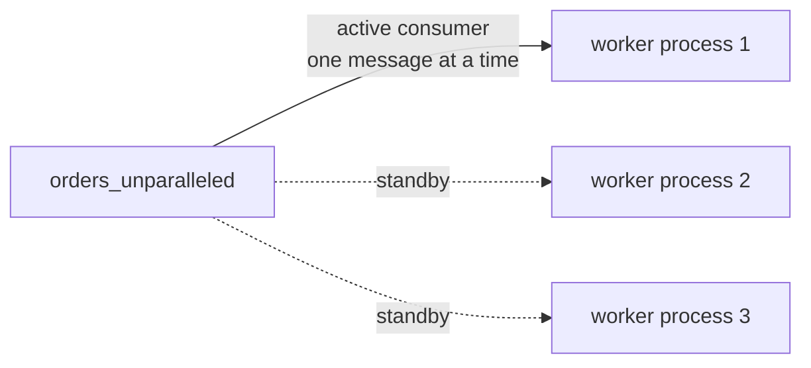
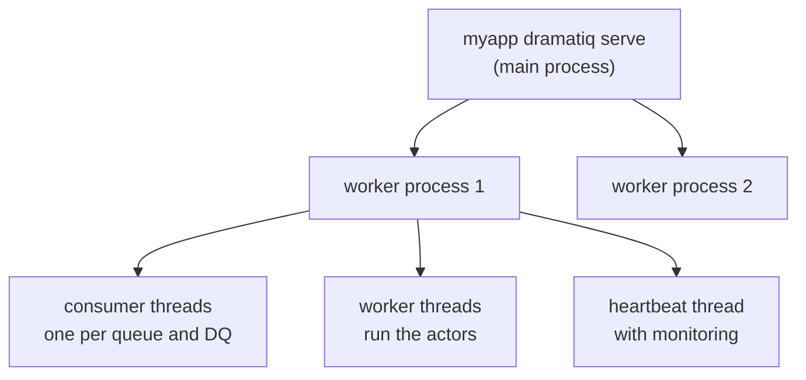
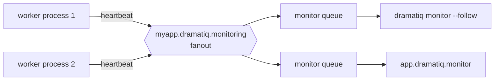

# The ```dramatiq``` extension

```tokeo.ext.dramatiq``` runs functions of your app as background tasks. You
mark a function as an *actor*; calling ```send``` on it does not run the function
but puts a message into RabbitMQ. Separate *worker* processes, started by
```myapp dramatiq serve```, take the messages and run the function there.

The extension builds on [dramatiq](https://dramatiq.io) and adds what an app
needs around it: the broker set up from the app config, a ```serve``` command
for the workers, queue management, monitoring of workers and queues, rate
limits through diskcache locks, and clear errors when RabbitMQ is not reachable.

.. note::

    RabbitMQ is the only supported broker. The extension relies on RabbitMQ
    features like dead letter queues, priorities and single active consumers.

.. note::

    The extension builds on ```tokeo.ext.tui.output``` (and with it the
    package ```rich```) for the displays of ```dramatiq queues``` and
    ```dramatiq monitor```. Enable both; without it the app stops at start
    with a ```TokeoError```.

## 1. How dramatiq works

Four parts work together:

- An actor is a function of your app decorated with ```@app.dramatiq.actor```.
  It belongs to a queue (```queue_name```, default ```default```).
- A message is what ```actor.send(...)``` creates: the actor name, the
  arguments and options as JSON. Arguments must be JSON-serializable.
- The broker is RabbitMQ. It keeps the messages in durable queues until a
  worker takes them.
- A worker is a process started by ```dramatiq serve```. It imports your app
  and its actors, consumes the queues and runs the actor functions in its
  worker threads.



Every queue comes with two companions that dramatiq declares together with it:

- ```<queue>.DQ``` holds delayed messages: sent with a ```delay``` or waiting
  for a retry.
- ```<queue>.XQ``` holds dead letters: messages that failed for good. RabbitMQ
  keeps them for ```rabbitmq.dead_message_ttl``` (7 days by default).

The life of one message, including a retry:



A message is acknowledged only after the actor finished. If a worker dies while
running it, RabbitMQ hands the message to another worker; actors should
therefore be safe to run twice (idempotent).

## 2. Quick start

Enable ```tokeo.ext.tui.output``` and ```tokeo.ext.dramatiq``` in the extensions
of the app and point it at your actors and RabbitMQ:

```yaml
# config/myapp/base.d/dramatiq.yaml
dramatiq:
  serve: myapp.main:dramatiq
  actors: myapp.core.tasks.actors
  worker_processes: 2
  worker_threads: 2
  rabbitmq:
    url: amqp://localhost:5672/
    auth_identity: guest
    auth_password: guest
```

Write an actor and send it a message:

```python
# myapp/core/tasks/actors.py
from tokeo.ext.appshare import app


@app.dramatiq.actor(queue_name='mail')
def send_welcome(email):
    # runs in a worker process, e.g. renders and sends the mail
    ...
```

```python
from myapp.core.tasks.actors import send_welcome

send_welcome.send('anna@example.com')    # returns at once, a worker sends the mail
```

Start the workers and watch them:

```bash
myapp dramatiq serve
myapp dramatiq queues
myapp dramatiq monitor --follow
```

## 3. Actors

Use ```@app.dramatiq.actor``` (or ```@dramatiq.actor``` with
```actor_class=TokeoActor```). It is dramatiq's decorator with one addition:
```send``` raises a ```TokeoDramatiqConnectionError``` that names the RabbitMQ
host when it cannot reach RabbitMQ, instead of a bare pika error.

```python
@app.dramatiq.actor(queue_name='reports', max_retries=3, time_limit=3_600_000)
def build_report(report_id):
    ...
```

The decorator takes these arguments:

<table border="1" cellpadding="6" cellspacing="0">
<thead>
<tr><th>Argument</th><th>Default</th><th>Meaning</th></tr>
</thead>
<tbody>
<tr><td>actor_name</td><td>the function name</td><td>unique name of the actor; messages refer to it, so renaming an actor orphans the messages in the queues</td></tr>
<tr><td>queue_name</td><td>'default'</td><td>the queue of its messages; a queue with '_unparalleled' in its name runs one task at a time (section 5)</td></tr>
<tr><td>priority</td><td>0</td><td>order inside a worker among messages it already fetched; <b>lower runs first</b> (section 4)</td></tr>
<tr><td>broker</td><td>the app broker</td><td>rarely needed</td></tr>
<tr><td>actor_class</td><td>TokeoActor</td><td>the actor class</td></tr>
</tbody>
</table>

Further options configure the middleware for this actor. Without them the
values from the config apply (section 7):

<table border="1" cellpadding="6" cellspacing="0">
<thead>
<tr><th>Option</th><th>Config default</th><th>Meaning</th></tr>
</thead>
<tbody>
<tr><td>max_retries</td><td>20</td><td>retries after a failure; 0 sends a failed message to the dead letters at once</td></tr>
<tr><td>min_backoff</td><td>15_000 ms</td><td>delay of the first retry; it about doubles with each retry (with jitter)</td></tr>
<tr><td>max_backoff</td><td>604_800_000 ms</td><td>longest delay of a retry; dramatiq caps it at 7 days</td></tr>
<tr><td>retry_when</td><td>-</td><td>callable(retries, exception) -> bool, decides instead of max_retries</td></tr>
<tr><td>throws</td><td>-</td><td>exception class(es) that are expected: no retry, logged as info</td></tr>
<tr><td>on_retry_exhausted</td><td>-</td><td>name of an actor called with the message once the retries are used up</td></tr>
<tr><td>time_limit</td><td>600_000 ms</td><td>longest run of the actor; then a TimeLimitExceeded is raised in it</td></tr>
<tr><td>max_age</td><td>None</td><td>messages older than this are not run but go to the dead letters</td></tr>
<tr><td>notify_shutdown</td><td>False</td><td>raise Shutdown in a running actor when its worker stops</td></tr>
<tr><td>on_success</td><td>-</td><td>name of an actor called with the message and the result</td></tr>
<tr><td>on_failure</td><td>-</td><td>name of an actor called with the message and the exception</td></tr>
<tr><td>pipe_ignore</td><td>False</td><td>in a pipeline, do not pass the previous result as argument</td></tr>
</tbody>
</table>

An option given with a message wins over the option of the actor, which wins
over the config.

Actors may be ```async def``` functions; they run on an event loop of the
worker. ```time_limit``` cannot be switched off, a long actor needs a long
limit.

.. note::

    The worker logs every failed run as error with its traceback. Use
    ```throws``` for exceptions that are part of the normal flow, so they are
    neither retried nor logged as errors.

## 4. Sending messages

<table border="1" cellpadding="6" cellspacing="0">
<thead>
<tr><th>Call</th><th>Purpose</th></tr>
</thead>
<tbody>
<tr><td>actor.send(*args, **kwargs)</td><td>enqueue a message with the arguments</td></tr>
<tr><td>actor.send_with_options(args=(), kwargs=None, delay=None, **options)</td><td>enqueue with a delay and message options</td></tr>
<tr><td>actor.message(*args, **kwargs)</td><td>build a message without sending it, for pipelines and groups</td></tr>
<tr><td>actor.message_with_options(args=(), kwargs=None, **options)</td><td>the same with message options</td></tr>
<tr><td>actor(*args, **kwargs)</td><td>call the function directly, here and now, without a queue</td></tr>
</tbody>
</table>

```send_with_options``` takes these options:

<table border="1" cellpadding="6" cellspacing="0">
<thead>
<tr><th>Option</th><th>Meaning</th></tr>
</thead>
<tbody>
<tr><td>delay</td><td>milliseconds (or a timedelta) before the message may run; it waits in the DQ</td></tr>
<tr><td>broker_priority</td><td>priority in RabbitMQ, 0 to rabbitmq.max_priority; <b>higher runs first</b></td></tr>
<tr><td>max_retries, min_backoff, max_backoff</td><td>retries of this message, like the actor options</td></tr>
<tr><td>time_limit, max_age, notify_shutdown</td><td>like the actor options, for this message</td></tr>
<tr><td>on_success, on_failure, on_retry_exhausted</td><td>actor names, like the actor options</td></tr>
</tbody>
</table>

Options must be JSON-serializable like the arguments; callables and exception
classes (```retry_when```, ```throws```) work as actor options only.

```python
from datetime import timedelta

remind.send_with_options(args=('anna@example.com',), delay=timedelta(hours=1))
build_report.send_with_options(args=(42,), broker_priority=9, max_retries=0)
```

### Two kinds of priority

They work at different places and in opposite directions:

<table border="1" cellpadding="6" cellspacing="0">
<thead>
<tr><th></th><th>broker_priority (message option)</th><th>priority (actor argument)</th></tr>
</thead>
<tbody>
<tr><td>where</td><td>RabbitMQ, within one queue</td><td>inside a worker, among messages it already fetched</td></tr>
<tr><td>order</td><td>higher first</td><td>lower first</td></tr>
<tr><td>needs</td><td>rabbitmq.max_priority in the config</td><td>nothing</td></tr>
<tr><td>effect</td><td>a waiting urgent message overtakes older ones</td><td>small, limited to the prefetched messages</td></tr>
</tbody>
</table>

```broker_priority``` only works when the queues were declared with
```x-max-priority```, see section 5 on changing that for existing queues.

### Pipelines and groups

dramatiq's ```pipeline``` runs messages one after the other and passes each
result on; ```group``` sends several messages at once:

```python
from dramatiq import pipeline, group

pipeline([fetch.message(url), parse.message(), store.message()]).run()
group([build_report.message(i) for i in range(10)]).run()
```

Waiting for results or for the completion of a group needs dramatiq's Results
middleware, which the extension does not set up.

### When RabbitMQ is not reachable

dramatiq tries six times, then ```send``` raises a
```TokeoDramatiqConnectionError``` like
```Cannot send send_welcome to rabbitmq at mq.example:5672 (...)!```. It is a
```TokeoError``` (the app shows it as a clean error) and a dramatiq
```ConnectionClosed``` (existing handlers keep working).

With ```rabbitmq.confirm_delivery``` (the default) ```send``` returns only after
RabbitMQ confirmed the message, and a message RabbitMQ cannot route to a queue
raises instead of being lost silently.

## 5. Queues

### One task at a time with ```_unparalleled```

A queue whose name contains ```_unparalleled``` runs one task at a time
across all workers:

- It is declared with RabbitMQ's ```x-single-active-consumer```: of all
  workers, only one process consumes it. The others stand by and take over
  when it stops.
- That process consumes it with a prefetch of 1, whatever
  ```queue_prefetch``` says: RabbitMQ hands out the next message only after
  the previous one is done. The other worker threads stay free for the other
  queues.

Use it for tasks that must not run twice at the same time, like the bookings
of one account or calls to an API that allows one request at a time.



.. caution::

    One task at a time does not keep the order. A message that fails waits in
    the DQ for its retry while the next messages run; a delayed message runs
    when it is due. Messages that are sent one after the other and never fail
    run in that order. Where the order matters, give the actor
    ```max_retries=0``` and handle a failure in the actor itself.

The delay queue of an unparalleled queue keeps its prefetch: the workers hold
its delayed messages until they are due and move them back into the queue,
where they wait for their turn.

### Delayed messages

A message with a ```delay``` and every retry wait in the DQ. Workers fetch them
early (up to ```delay_queue_prefetch```) and keep them in memory until they are
due, then move them back into the queue. The count of delayed messages in
RabbitMQ therefore misses those already fetched.

### Dead letters

A message that failed for good goes to the XQ: after ```max_retries```
failures, when it was older than ```max_age```, or at once when its exception
matches ```throws```. Inspect and handle dead letters with ```dramatiq queues```
(section 8).

.. note::

    A dead letter keeps the state of its last retry: its error text and
    retry count are those of the previous attempt, the error of the final
    attempt is only in the worker log (and in the monitor). With
    ```max_retries=0``` there is no retry, so its dead letter has no error text
    and ```retries``` stays 0. ```on_retry_exhausted``` gets the complete
    message, including the final error, when an app must keep it.

### Changing queue arguments (PRECONDITION_FAILED)

RabbitMQ fixes the arguments of a queue when it is created. Changing
```rabbitmq.max_priority``` or ```rabbitmq.dead_message_ttl``` later does not
alter existing queues; workers and ```send``` then fail with messages like:

```
PRECONDITION_FAILED - inequivalent arg 'x-max-priority' for queue 'mail' in
vhost '/': received the value '5' of type 'signedint' but current is none

PRECONDITION_FAILED - inequivalent arg 'x-message-ttl' for queue 'mail.XQ' in
vhost '/': received '60000' but current is '604800000'
```

Declare the queues again with the new arguments, after the workers stopped:

```bash
myapp dramatiq queues --recreate --yes            # empty queues only
myapp dramatiq queues mail --recreate --yes --force   # drops their messages
```

## 6. Workers with ```dramatiq serve```

```serve``` starts dramatiq's worker pool from the config; the switches override
single values:



<table border="1" cellpadding="6" cellspacing="0">
<thead>
<tr><th>Switch</th><th>Meaning</th></tr>
</thead>
<tbody>
<tr><td>-p, --processes N|auto</td><td>worker processes; auto follows the dramatiq default (number of CPUs)</td></tr>
<tr><td>-t, --threads N</td><td>worker threads per process</td></tr>
<tr><td>--queues QUEUE ...</td><td>consume only these queues; all queues of the actors without it</td></tr>
<tr><td>--queue-prefetch N|auto</td><td>messages to fetch ahead per queue; auto is threads × 2; unparalleled queues always fetch 1</td></tr>
<tr><td>--delay-queue-prefetch N|auto</td><td>messages to fetch ahead per DQ; auto is threads × 1000</td></tr>
<tr><td>--worker-shutdown-timeout MS</td><td>how long a stopping worker waits for running actors</td></tr>
<tr><td>--use-spawn / --use-forkserver</td><td>how the worker processes start; forkserver is the default</td></tr>
<tr><td>--watch PATH</td><td>restart the workers when files below PATH change (development)</td></tr>
<tr><td>--no-purge</td><td>keep the diskcache locks on start and on restarts by --watch</td></tr>
<tr><td>--skip-logging</td><td>do not let dramatiq set up the logging; without it dramatiq logs on debug level when the app runs with --debug</td></tr>
</tbody>
</table>

The worker processes start by forkserver (or by spawn where forkserver is
not available): they do not inherit the state of the main process, so its open
connections like gRPC channels or database pools do not leak into them.

On ```SIGTERM``` or ```Ctrl-C``` the workers stop fetching, let running actors
finish within ```worker_shutdown_timeout``` and leave unfinished messages to
RabbitMQ. If one worker process dies unexpectedly, dramatiq stops the whole
pool; run ```serve``` under a supervisor like systemd that restarts it.

### Connections to RabbitMQ

Each worker process holds about 4 connections per queue it consumes (the
queue and its DQ), 1 more with monitoring, and 1 per worker thread that
sends messages itself. ```dramatiq queues``` and ```dramatiq monitor``` hold one
while they run. For example 2 processes consuming 3 queues with monitoring:
2 × (3 × 4 + 1) = 26 connections. Bind workers to fewer queues with ```--queues```
when RabbitMQ limits the connections.

### Environment variables

dramatiq reads some settings from the environment when it is imported. The
extension sets most of them from the config for the workers; two are worth
knowing:

<table border="1" cellpadding="6" cellspacing="0">
<thead>
<tr><th>Variable</th><th>Meaning</th></tr>
</thead>
<tbody>
<tr><td>dramatiq_dead_message_ttl</td><td>lifetime of dead letters in milliseconds, used when rabbitmq.dead_message_ttl is null; dramatiq's default is 7 days. The extension checks it is an integer of at least 1, as 0 would drop every dead letter at once.</td></tr>
<tr><td>dramatiq_worker_timeout</td><td>how often idle worker threads wake up, in milliseconds, used when worker_poll_interval is null; dramatiq's default is 1000. It is checked before the workers start.</td></tr>
</tbody>
</table>

Do not set ```dramatiq_restart_delay```, ```dramatiq_queue_prefetch``` or
```dramatiq_delay_queue_prefetch``` yourself: ```serve``` sets them from the config.

## 7. Configuration

All values live in the ```dramatiq``` section; missing keys of the
```rabbitmq``` block take their defaults. Invalid values stop the app at start
with a ```TokeoDramatiqConfigError``` that names the key.

<table border="1" cellpadding="6" cellspacing="0">
<thead>
<tr><th>Key</th><th>Default</th><th>Meaning</th></tr>
</thead>
<tbody>
<tr><td>serve</td><td>'main:method'</td><td>module:function the workers call to set up the app</td></tr>
<tr><td>actors</td><td>'actors.module'</td><td>module with the actors, imported by the workers and by dramatiq queues</td></tr>
<tr><td>worker_processes</td><td>2</td><td>worker processes, or auto for the number of CPUs</td></tr>
<tr><td>worker_threads</td><td>1</td><td>worker threads per process</td></tr>
<tr><td>worker_shutdown_timeout</td><td>600_000</td><td>milliseconds a stopping worker waits for running actors</td></tr>
<tr><td>restart_delay</td><td>3_000</td><td>milliseconds before a consumer reconnects after losing RabbitMQ</td></tr>
<tr><td>worker_poll_interval</td><td>None</td><td>milliseconds idle worker threads wake up; None uses dramatiq_worker_timeout or 1000</td></tr>
<tr><td>queue_prefetch</td><td>'auto'</td><td>messages fetched ahead per queue; auto (or 0) is threads × 2; unparalleled queues always fetch 1</td></tr>
<tr><td>delay_queue_prefetch</td><td>'auto'</td><td>messages fetched ahead per DQ; auto (or 0) is threads × 1000</td></tr>
<tr><td>use_spawn</td><td>False</td><td>start the worker processes by spawn instead of forkserver</td></tr>
<tr><td>time_limit</td><td>600_000</td><td>default time_limit of the actors in milliseconds</td></tr>
<tr><td>max_age</td><td>None</td><td>default max_age of the messages in milliseconds; None for no limit</td></tr>
<tr><td>notify_shutdown</td><td>False</td><td>default notify_shutdown of the actors</td></tr>
<tr><td>max_retries</td><td>20</td><td>default max_retries of the actors</td></tr>
<tr><td>min_backoff</td><td>15_000</td><td>default min_backoff in milliseconds</td></tr>
<tr><td>max_backoff</td><td>604_800_000</td><td>default max_backoff in milliseconds, at most 7 days</td></tr>
<tr><td>monitoring</td><td>False</td><td>send a heartbeat of each worker process for the monitor (section 9)</td></tr>
<tr><td>monitoring_interval</td><td>5</td><td>seconds between two heartbeats</td></tr>
<tr><td>monitoring_with_details</td><td>'debug'</td><td>send task arguments and error texts: off, on or debug (on with --debug)</td></tr>
<tr><td>broker</td><td>'rabbitmq'</td><td>the broker, only rabbitmq</td></tr>
<tr><td>locks_tag</td><td>'dramatiq_locks'</td><td>diskcache tag of the locks</td></tr>
<tr><td>locks_key_prefix</td><td>'dq_'</td><td>prefix of the lock keys</td></tr>
<tr><td>locks_sleep_time</td><td>0.1</td><td>seconds between two checks of a waiting lock or temper call</td></tr>
</tbody>
</table>

The ```rabbitmq``` block:

<table border="1" cellpadding="6" cellspacing="0">
<thead>
<tr><th>Key</th><th>Default</th><th>Meaning</th></tr>
</thead>
<tbody>
<tr><td>url</td><td>'amqp://localhost:5672/'</td><td>connection url; amqps:// enables TLS, verified against the system CA store</td></tr>
<tr><td>auth_identity</td><td>None</td><td>user name, overrides a user in the url</td></tr>
<tr><td>auth_password</td><td>None</td><td>password, overrides a password in the url</td></tr>
<tr><td>tls_verify_hostname</td><td>True</td><td>check the certificate host name; a string pins the expected name</td></tr>
<tr><td>tls_verify_cert</td><td>True</td><td>check the certificate chain</td></tr>
<tr><td>tls_ca</td><td>None</td><td>CA bundle to trust instead of the system store</td></tr>
<tr><td>confirm_delivery</td><td>True</td><td>send returns after RabbitMQ confirmed the message</td></tr>
<tr><td>max_priority</td><td>None</td><td>highest broker_priority of the queues, 1 to 255; None for no priorities</td></tr>
<tr><td>dead_message_ttl</td><td>None</td><td>lifetime of dead letters in milliseconds; None uses the env or 7 days</td></tr>
</tbody>
</table>

```monitoring_with_details``` takes ```off```, ```false```, ```no``` or ```null```
(never), ```on```, ```true``` or ```yes``` (always) and ```debug``` (only when the
workers run with ```--debug```).

## 8. Queue management with ```dramatiq queues```

```bash
myapp dramatiq queues                       # state of all queues of the actors
myapp dramatiq queues mail --dead 5         # with the first 5 dead letters
myapp dramatiq queues mail --requeue-dead --yes
myapp dramatiq queues --json
```

<table border="1" cellpadding="6" cellspacing="0">
<thead>
<tr><th>Switch</th><th>Meaning</th></tr>
</thead>
<tbody>
<tr><td>QUEUE ...</td><td>the queues to handle; all queues of the actors without</td></tr>
<tr><td>--dead [N]</td><td>show the first N dead letters (10), they stay in place</td></tr>
<tr><td>--purge</td><td>remove the messages of queue, DQ and XQ, keep the queues</td></tr>
<tr><td>--dead-only</td><td>with --purge, only the dead letters</td></tr>
<tr><td>--requeue-dead</td><td>move dead letters back into their queue, with fresh retries</td></tr>
<tr><td>--limit N</td><td>dead letters to move by --requeue-dead, all without</td></tr>
<tr><td>--delete</td><td>delete queue, DQ and XQ</td></tr>
<tr><td>--recreate</td><td>delete and declare them again with the current arguments</td></tr>
<tr><td>--force</td><td>delete or recreate also queues with messages or consumers</td></tr>
<tr><td>--yes</td><td>confirm a change of queues or messages</td></tr>
<tr><td>--json</td><td>print the result as json</td></tr>
</tbody>
</table>

The table shows ready, delayed and dead messages, the consumers and hints:
```missing``` (the queue does not exist yet), ```unparalleled```,
```no consumer``` (no worker consumes it) and ```no actor``` (no actor of the app
uses it). The state never creates a missing queue. Long values end with an
ellipsis, ```--json``` shows them in full.

The same is available in code as ```app.dramatiq.queues```:

<table border="1" cellpadding="6" cellspacing="0">
<thead>
<tr><th>Method</th><th>Purpose</th></tr>
</thead>
<tbody>
<tr><td>names()</td><td>the queue names of the actors</td></tr>
<tr><td>state(names=None, cache_ttl=0)</td><td>one dict per queue; a cache_ttl keeps the state for further calls</td></tr>
<tr><td>peek_dead(name, limit=10)</td><td>dead letters with message_id, actor, retries, error, args and timestamp</td></tr>
<tr><td>requeue_dead(name, limit=None)</td><td>move dead letters back, resetting retries and traceback</td></tr>
<tr><td>purge(names=None, dead_only=False)</td><td>remove messages</td></tr>
<tr><td>delete(names=None, force=False)</td><td>delete queues</td></tr>
<tr><td>recreate(names=None, force=False)</td><td>declare queues again</td></tr>
</tbody>
</table>

It keeps one connection to RabbitMQ for its calls and opens it again when
RabbitMQ closed it in the meantime; it is safe to use from several threads.

## 9. Monitoring with ```dramatiq monitor```

With ```monitoring: true``` every worker process sends a small heartbeat
every ```monitoring_interval``` seconds to the fanout exchange
```<app label>.dramatiq.monitoring```. Each running monitor listens on a queue of
its own, so any number of monitors see the same workers:



```bash
myapp dramatiq monitor                      # one display
myapp dramatiq monitor --follow             # display again and again until Ctrl-C
myapp dramatiq monitor --follow --interval 2
myapp dramatiq monitor --json               # one line per display with --follow
```

The display shows the worker processes with their state, threads in use and
counters, the running tasks, the actors of the last heartbeats and the queues.
In a terminal ```--follow``` repaints in place; into a file or a pipe it appends
one block per display.

A worker is ```ok``` while its heartbeats arrive, ```late``` after 2 and ```gone```
after 3 of its intervals without one, and ```stopped``` at once when it shut
down cleanly. Gone and stopped workers stay in the display for 10 more
intervals. The monitor measures by its own clock and the interval each worker
reports, so differing clocks or intervals do not matter.

.. note::

    A monitor knows only the workers it heard of since it started; its first
    display waits one interval. A heartbeat is a snapshot: tasks that started
    and ended between two heartbeats do not show as running, but in the
    counters and in the summary of the last heartbeat.

A heartbeat looks like this (```args``` and ```last_error``` texts with details
only):

```json
{
  "type": "tokeo.dramatiq.heartbeat", "version": 1, "state": "running",
  "interval": 5, "sent_at": 1761100800000,
  "app": {"label": "myapp", "version": "2.1.0"},
  "worker": {"host": "worker-01", "pid": 4711, "started_at": 1761097200000,
             "threads": 8, "queues": null, "queue_prefetch": 16,
             "delay_queue_prefetch": 8000, "details": true},
  "running": [{"message_id": "3f2a9c1e-...", "actor": "send_mail", "queue": "mail",
               "retries": 0, "started_at": 1761100798800, "runtime_ms": 1200,
               "args": "(('anna@example.com',), {})"}],
  "totals": {"done": 102, "failed": 3, "dead": 1},
  "since_last": {"ms": 5000, "actors": {
      "send_mail": {"done": 2, "failed": 1, "max_runtime_ms": 1400,
                    "last_error": "SMTPRecipientsRefused: ..."}}}
}
```

Without details ```args``` is missing and ```last_error``` holds the exception
type only, as task arguments and error texts may hold personal data or secrets.

Heartbeats cost RabbitMQ little: one connection per worker process and a message
of about 1 KB per interval. They are not confirmed, not written to disk and
dropped at once while no monitor listens; a monitor queue limits its length and
the age of its messages, so a stuck monitor piles nothing up.

In code, ```app.dramatiq.monitor.workers(wait=0)``` returns the workers with their
state and last heartbeat, ```app.dramatiq.monitor.snapshot(wait=0)``` adds the
summed actors and the queues, the data of ```--json```.

## 10. Locks and rate limits

With the extension ```tokeo.ext.diskcache``` enabled, ```app.dramatiq.locks```
limits how often or how many actors run at once:

```python
@app.dramatiq.actor(queue_name='api_calls')
@app.dramatiq.locks.throttle(count=10, per_seconds=60)    # at most 10 per minute
def call_api(resource_id):
    ...


@app.dramatiq.actor(queue_name='exports')
@app.dramatiq.locks.temper(count=2)                       # at most 2 at once
def export(customer_id):
    ...
```

The locks live in the diskcache directory, so they count across all worker
processes of one machine. The directory must be local: SQLite does not lock
reliably over a network file system.
```serve``` purges stale locks on start, ```dramatiq locks --purge``` does it by
hand.

A call that waits for a lock or a free slot of ```temper``` checks the cache
every ```locks_sleep_time``` seconds (section 7), ```sleep_time``` of the call
overrides it.

## 11. Errors

All errors derive from ```TokeoDramatiqError``` (a ```TokeoError```) and keep
their details as fields:

<table border="1" cellpadding="6" cellspacing="0">
<thead>
<tr><th>Error</th><th>Raised when</th><th>Fields</th></tr>
</thead>
<tbody>
<tr><td>TokeoDramatiqConfigError</td><td>a config value, env or switch is not allowed</td><td>source, name, value, expected</td></tr>
<tr><td>TokeoDramatiqConnectionError</td><td>RabbitMQ is not reachable; also a dramatiq ConnectionClosed</td><td>address, cause, actor_name</td></tr>
<tr><td>TokeoDramatiqRefusedError</td><td>RabbitMQ refused a request, e.g. missing permissions</td><td>address, cause</td></tr>
<tr><td>TokeoDramatiqQueueError</td><td>the state of a queue prevents an action</td><td>queue, reason</td></tr>
<tr><td>TokeoDramatiqError</td><td>switches that do not fit, locks without diskcache</td><td>-</td></tr>
</tbody>
</table>

```address``` is host and port, never the url with its password; ```cause``` is
the text of the underlying error, the error itself stays in ```__cause__```. The
errors survive copy and pickle, so they also come back from a process pool.
